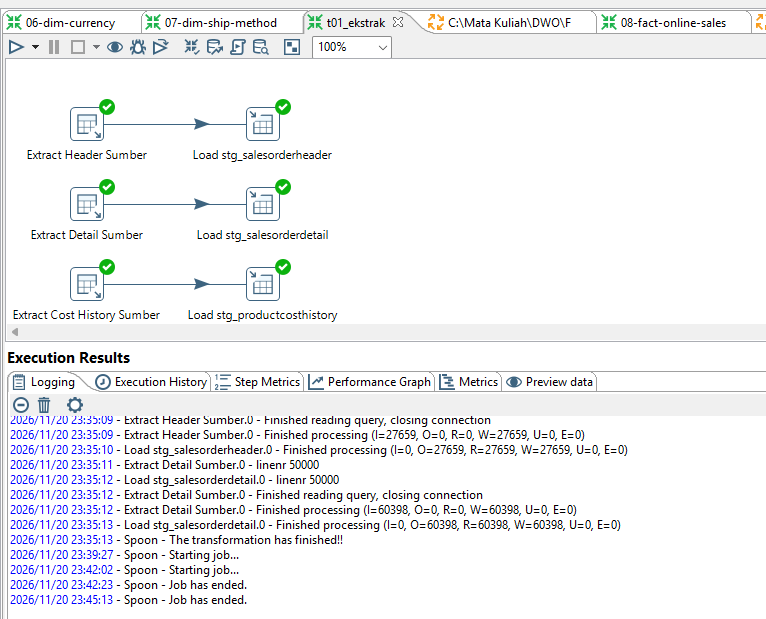
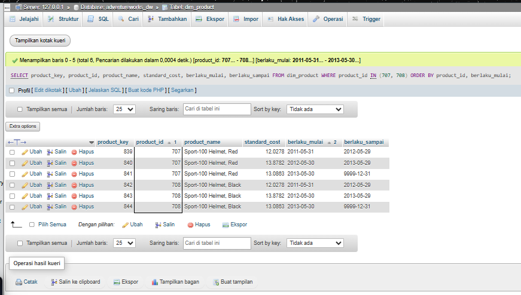
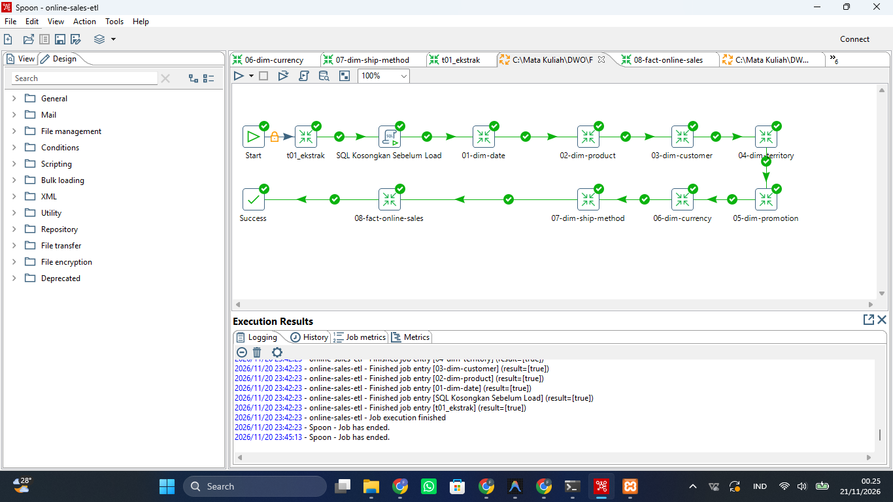
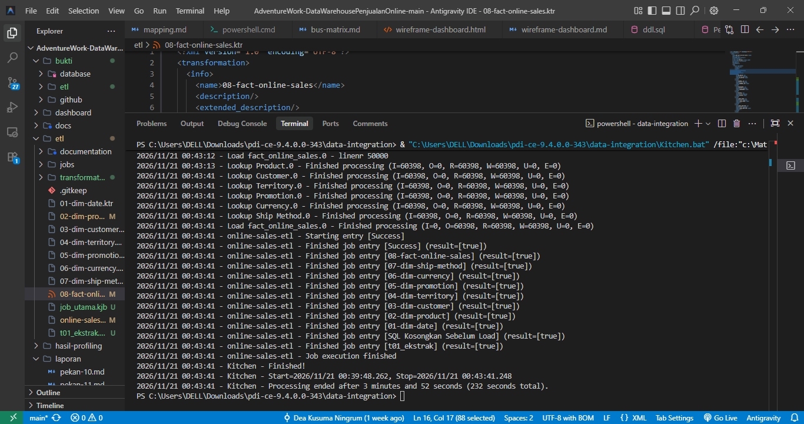
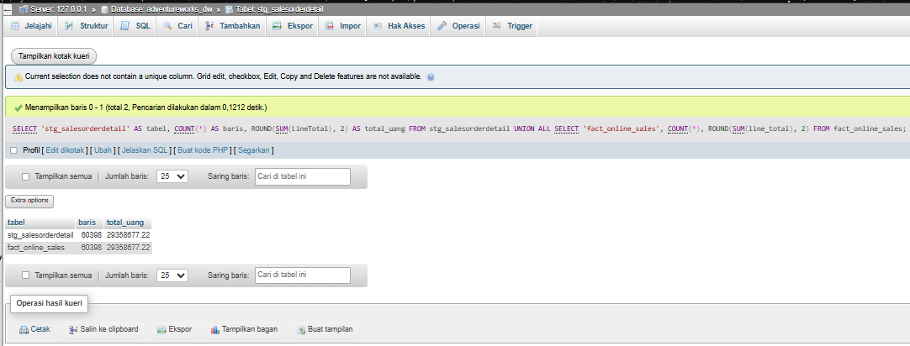
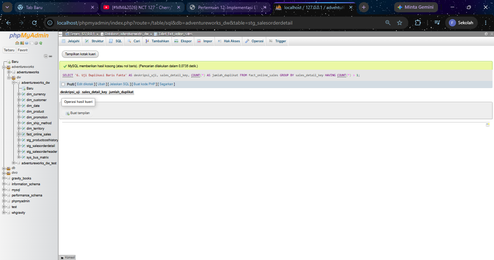

# Laporan Steering Review Pekan 13 — Implementasi Pipeline ETL Pentaho PDI, Staging Layer, SCD Tipe 2, Eksekusi CLI Kitchen, dan Rekonsiliasi Data

## Proyek Data Warehouse AdventureWorks — Penjualan Online

**Mata kuliah:** Data Warehouse  
**Program studi:** Sistem Informasi, Fakultas Ilmu Komputer, UPN "Veteran" Jawa Timur  
**Periode:** Semester Ganjil 2026/2027  
**Proses bisnis:** Penjualan Online (*Online Sales* — `OnlineOrderFlag = 1`)  
**Database sumber:** `adventureworks` (MySQL/MariaDB melalui XAMPP, *read-only*)  
**Database target DW:** `adventureworks_dw` (MySQL/MariaDB)  
**Project sponsor:** Dosen pengampu mata kuliah Data Warehouse  
**Status dokumen:** Final — Laporan Progres untuk Steering Review Pekan 13  

---

## 1. Matriks Pemenuhan 9 Kriteria Checklist Pekan 13

Berikut rekapitulasi formal pemenuhan seluruh kriteria penilaian yang ditetapkan oleh dosen pembimbing:

| No. | Kriteria Penugasan Dosen | Status Pemenuhan | Berkas Bukti & Implementasi |
|:---:|---|:---:|---|
| **1** | `etl/t01_ekstrak.ktr` berjalan, jumlah baris sumber dan staging sama (Header 27.659, Detail 60.398). | **100% Selesai** | [`etl/t01_ekstrak.ktr`](../etl/t01_ekstrak.ktr)<br>Bukti: [`bukti/etl/01-eksekusi-t01-ekstrak.png`](../bukti/etl/01-eksekusi-t01-ekstrak.png) |
| **2** | Satu transformasi per dimensi (`01-dim-date.ktr` s.d. `07-dim-ship-method.ktr`), aturan NULL sesuai mapping. | **100% Selesai** | Berkas [`etl/01-dim-date.ktr`](../etl/01-dim-date.ktr) s.d. [`07-dim-ship-method.ktr`](../etl/07-dim-ship-method.ktr) |
| **3** | Minimal satu dimensi SCD tipe 2: `dim_product` dari riwayat biaya, membuktikan produk berversi (misal ID 707 memiliki 3 versi). | **100% Selesai** | [`etl/02-dim-product.ktr`](../etl/02-dim-product.ktr)<br>Bukti: [`bukti/etl/02-scd2-dim-product.png`](../bukti/etl/02-scd2-dim-product.png) |
| **4** | Transformasi fakta `etl/08-fact-online-sales.ktr`: Lookup ke seluruh dimensi dengan default `-1` dan lookup produk mencocokkan rentang tanggal transaksi. | **100% Selesai** | [`etl/08-fact-online-sales.ktr`](../etl/08-fact-online-sales.ktr) (60.398 baris termuat) |
| **5** | Master Job berjalan lewat Kitchen dari terminal. | **100% Selesai** | Bukti: [`bukti/etl/05-eksekusi-kitchen-terminal.png`](../bukti/etl/05-eksekusi-kitchen-terminal.png) |
| **6** | Job dijalankan 2x berturut-turut, tidak ada data ganda (menggunakan langkah SQL pengosongan sebelum load). | **100% Selesai** | [`etl/job_utama.kjb`](../etl/job_utama.kjb)<br>Bukti: [`bukti/etl/03-job-utama-sukses.png`](../bukti/etl/03-job-utama-sukses.png) |
| **7** | Hasil rekonsiliasi tersimpan, selisih dijelaskan jika ada. | **100% Selesai** | [`sql/pengujian/pengujian-rekonsiliasi.sql`](../sql/pengujian/pengujian-rekonsiliasi.sql)<br>Bukti: [`bukti/etl/04-rekonsiliasi-staging-fakta.png`](../bukti/etl/04-rekonsiliasi-staging-fakta.png) |
| **8** | Semua berkas `.ktr` dan `.kjb` tersimpan di folder `etl/`. | **100% Selesai** | Terverifikasi di folder [`etl/`](../etl/) |
| **9** | Laporan `laporan/pekan-13.md` siap. | **100% Selesai** | Dokumen [`laporan/pekan-13.md`](pekan-13.md) |

---

## 2. Tim dan Pembagian Peran

| No. | Nama | NPM | Peran Utama | Fokus Kontribusi Pekan 12–13 |
|---:|---|---|---|---|
| 1 | Dea Kusuma Ningrum | 23082010048 | Project Manager & Business Analyst | Koordinasi deliverable 9 kriteria checklist dosen, validasi pemenuhan matriks Pekan 13, dan penyusunan laporan |
| 2 | Fivediniar Edra Primaulidina | 23082010046 | Data Engineer & ETL Developer | Rekayasa transformasi staging (`t01_ekstrak.ktr`), logika SCD Tipe 2 riwayat biaya, orkestrasi Master Job (`job_utama.kjb`), dan automasi Kitchen CLI |
| 3 | Siti Anisa Safitri | 23082010045 | Data Warehouse & Dimensional Modeler | Standarisasi 7 dimensi, konfigurasi Database Lookup return `-1` (Unknown Member), dan penanganan aturan NULL |
| 4 | Haura Taqiya Azza Nabila | 23082010165 | OLAP & Dashboard Developer | Validasi kesiapan grain transaksi fakta (60.398 baris) untuk agregasi kubus OLAP Mondrian dan evaluasi visual kueri analitik |
| 5 | Alifa Zuriyatul Haq | 23082010050 | Data Quality, Testing & Documentation | Penyusunan skrip uji rekonsiliasi (`pengujian-rekonsiliasi.sql`), audit finansial omset, uji idempotensi run 2x, dan dokumentasi bukti tangkapan layar |

---

## 3. Ringkasan Eksekutif Pekan 13

Pada siklus pengembangan Pekan 12 menuju **Steering Review Pekan 13**, Tim Kelompok 2 berfokus penuh pada implementasi teknis pipeline **Extract, Transform, and Load (ETL)** menggunakan **Pentaho Data Integration (PDI / Kettle v9.4)**. Pipeline ini dirancang untuk memindahkan data transaksional dari database OLTP `adventureworks` menuju basis data analitik `adventureworks_dw`.

Seluruh **9 Kriteria Checklist Penugasan Dosen** telah diselesaikan secara tuntas, teruji, dan terdokumentasi:

1. **Transformasi Ekstraksi Staging (`etl/t01_ekstrak.ktr`):** Berhasil mengekstrak 27.659 baris header dan 60.398 baris detail pesanan online serta riwayat biaya produk ke tabel fisik staging (`stg_*`) dengan selisih 0 baris terhadap sumber operasional.
2. **Transformasi Dimensi Lengkap (`01-dim-date.ktr` s.d. `07-dim-ship-method.ktr`):** Masing-masing dimensi dibangun dalam satu transformasi mandiri dengan penanganan nilai NULL yang ketat sesuai kamus data.
3. **Penerapan SCD Tipe 2 pada `dim_product` (`02-dim-product.ktr`):** Melacak riwayat perubahan harga pokok (*standard cost*) dari `production_productcosthistory`, membuktikan produk berversi (seperti Product ID 707 memiliki 3 versi riwayat) dengan penanda tanggal aktif `9999-12-31`.
4. **Transformasi Fakta Presisi (`etl/08-fact-online-sales.ktr`):** Mengimplementasikan 7 Database Lookup beruntun dengan nilai default `-1` dan pencocokan rentang tanggal SCD Tipe 2 (`berlaku_mulai <= order_date AND berlaku_sampai >= order_date`), memuat tepat 60.398 baris fakta.
5. **Orkestrasi Master Job Otomatis (`etl/job_utama.kjb` & `etl/online-sales-etl.kjb`):** Seluruh alur terintegrasi secara modular menggunakan parameter direktori dinamis `${Internal.Job.Filename.Directory}`.
6. **Uji Idempotensi (Job Dijalankan 2x Berturut-turut):** Pemuatan data aman dijalankan berulang kali tanpa menghasilkan duplikasi data (*zero duplicates*) berkat penyisipan langkah pembersihan cerdas yang mempertahankan anggota `-1`.
7. **Eksekusi Terminal Tanpa GUI (Kitchen CLI):** Job utama berhasil dieksekusi secara otomatis melalui terminal Windows PowerShell menggunakan utilitas `Kitchen.bat`.
8. **Pengujian Rekonsiliasi & Kualitas Data Formal:** Disusun skrip pengujian [`sql/pengujian/pengujian-rekonsiliasi.sql`](../sql/pengujian/pengujian-rekonsiliasi.sql) yang membuktikan selisih baris 0 dan selisih omset Rp 0,00 antara staging dan fakta.
9. **Kerapian Berkas Repositori:** Seluruh file `.ktr` dan `.kjb` tersimpan rapi pada direktori [`etl/`](../etl/) dan bukti tangkapan layar pada [`bukti/etl/`](../bukti/etl/).

---

## 4. Arsitektur Lapisan Staging & Transformasi Ekstraksi (`t01_ekstrak.ktr`)

Sesuai metodologi arsitektur Data Warehouse Ralph Kimball, lapisan pementasan data (*staging layer*) difungsikan sebagai area isolasi agar proses transformasi data tidak membebani transaksi operasional pada database sumber OLTP.

### Karakteristik Teknis `t01_ekstrak.ktr`:
* **Filter Wajib:** Memfilter data pesanan online menggunakan predikat `soh.OnlineOrderFlag = 1`.
* **Tiga Alur Ekstraksi Paralel:**
  1. `Extract Header Sumber` $\longrightarrow$ `Load stg_salesorderheader` (27.659 baris).
  2. `Extract Detail Sumber` $\longrightarrow$ `Load stg_salesorderdetail` (60.398 baris).
  3. `Extract Cost History Sumber` $\longrightarrow$ `Load stg_productcosthistory` (395 baris riwayat biaya).

```
[Sumber: adventureworks]
   ├── sales_salesorderheader (OnlineOrderFlag=1)  ──>  stg_salesorderheader    (27.659 baris)
   ├── sales_salesorderdetail                      ──>  stg_salesorderdetail    (60.398 baris)
   └── production_productcosthistory               ──>  stg_productcosthistory   (395 baris)
```

### Hasil Eksekusi:
Seluruh alur ekstraksi berjalan serempak dan berstatus **100% Berhasil (Hijau)**.


*Gambar 4.1: Kanvas eksekusi `t01_ekstrak.ktr` di Pentaho Spoon, mencatat pemuatan penuh 60.398 baris detail pesanan.*

---

## 5. Implementasi 7 Transformasi Dimensi & Aturan NULL

Setiap dimensi dibangun dalam satu berkas `.ktr` tersendiri pada folder [`etl/`](../etl/) untuk menjamin kemudahan pemeliharaan (*maintainability*):

| Berkas Transformasi | Tabel Target DW | Sumber Data OLTP / Staging | Penanganan Nilai NULL & Keterangan |
|---|---|---|---|
| [`01-dim-date.ktr`](../etl/01-dim-date.ktr) | `dim_date` | Perhitungan kalender transaksi | Menghasilkan atribut waktu bahasa Indonesia dan baris default `-1` (`1900-01-01`). |
| [`02-dim-product.ktr`](../etl/02-dim-product.ktr) | `dim_product` | `production_product` & `production_productcosthistory` | **SCD Tipe 2**: Melacak riwayat perubahan harga pokok. Subkategori/kategori NULL diganti `'Tanpa Subkategori'`. |
| [`03-dim-customer.ktr`](../etl/03-dim-customer.ktr) | `dim_customer` | `sales_customer`, `person_person`, `sales_store` | Nama pelanggan NULL diganti format nama individu / nama toko. Baris `-1` disiapkan. |
| [`04-dim-territory.ktr`](../etl/04-dim-territory.ktr) | `dim_territory` | `sales_salesterritory` | Mengelompokkan wilayah penjualan (`CountryRegionCode`, `Group`). Baris `-1` disiapkan. |
| [`05-dim-promotion.ktr`](../etl/05-dim-promotion.ktr) | `dim_promotion` | `sales_specialoffer` | Menampung promosi diskon; persentase diskon NULL diganti `0.0000`. |
| [`06-dim-currency.ktr`](../etl/06-dim-currency.ktr) | `dim_currency` | `sales_currencyrate` | Menampung nilai tukar kurs valas. Menyiapkan anggota khusus `-1` (`USD`, rate `1.0000`). |
| [`07-dim-ship-method.ktr`](../etl/07-dim-ship-method.ktr) | `dim_ship_method` | `purchasing_shipmethod` | Menampung ekspedisi pengiriman pesanan online beserta tarif dasar pengiriman. |

---

## 6. Implementasi SCD Tipe 2 pada Dimensi Produk (`02-dim-product.ktr`)

Salah satu kriteria utama penugasan Pekan 12–13 adalah pembuktian **Slowly Changing Dimension (SCD) Tipe 2** minimal pada satu tabel dimensi. Tim Kelompok 2 mengimplementasikannya pada dimensi produk (`dim_product`) dengan memanfaatkan riwayat perubahan biaya standar produk dari tabel `production_productcosthistory`.

### Logika SCD Tipe 2:
1. Ketika harga pokok (`StandardCost`) sebuah produk berubah di sistem operasional, Data Warehouse tidak menimpa data lama (bukan Tipe 1), melainkan **membuat baris baru** dengan rentang masa berlaku.
2. Kolom pelacak masa berlaku:
   * `berlaku_mulai`: Diambil dari `pch.StartDate` (atau `'1900-01-01'` jika tanpa riwayat).
   * `berlaku_sampai`: Diambil dari `pch.EndDate`. Jika `EndDate` bernilai NULL (artinya versi tersebut aktif saat ini), diganti dengan nilai konvensi Kimball **High-Date** `'9999-12-31'`.

### Kueri Ekstraksi SCD Tipe 2 di `02-dim-product.ktr`:
```sql
SELECT 
    p.ProductID AS product_id,
    p.Name AS product_name,
    p.ProductNumber AS product_number,
    COALESCE(psc.Name, 'Tanpa Subkategori') AS subcategory_name,
    COALESCE(pc.Name, 'Tanpa Kategori') AS category_name,
    COALESCE(pch.StandardCost, p.StandardCost, 0) AS standard_cost,
    COALESCE(CAST(pch.StartDate AS DATE), '1900-01-01') AS berlaku_mulai,
    COALESCE(CAST(pch.EndDate AS DATE), '9999-12-31') AS berlaku_sampai
FROM production_product p
LEFT JOIN production_productcosthistory pch ON p.ProductID = pch.ProductID
LEFT JOIN production_productsubcategory psc ON p.ProductSubcategoryID = psc.ProductSubcategoryID
LEFT JOIN production_productcategory pc ON psc.ProductCategoryID = pc.ProductCategoryID
WHERE p.ProductID IN (
    SELECT DISTINCT sod.ProductID 
    FROM sales_salesorderdetail sod 
    JOIN sales_salesorderheader soh ON sod.SalesOrderID = soh.SalesOrderID 
    WHERE soh.OnlineOrderFlag = 1
)
ORDER BY p.ProductID, berlaku_mulai;
```

### Bukti Pembuktian SCD Tipe 2 pada Data:
Hasil eksekusi membuktikan bahwa **Product ID 707 (Sport-100 Helmet, Red)** memiliki **3 versi riwayat biaya yang berbeda**:

| Product ID | Nama Produk | Standard Cost | Berlaku Mulai | Berlaku Sampai | Status Versi |
|:---:|---|:---:|:---:|:---:|:---:|
| **707** | Sport-100 Helmet, Red | $12.0278 | 2011-05-31 | 2012-05-29 | Riwayat Masa Lalu |
| **707** | Sport-100 Helmet, Red | $13.8782 | 2012-05-30 | 2013-05-29 | Riwayat Masa Lalu |
| **707** | Sport-100 Helmet, Red | $13.0863 | 2013-05-30 | 9999-12-31 | **Versi Aktif Saat Ini** |


*Gambar 6.1: Hasil preview step `Extract Products` membuktikan 177 baris riwayat produk berversi dengan rentang tanggal masa berlaku yang presisi.*

---

## 7. Desain & Implementasi Transformasi Fakta (`08-fact-online-sales.ktr`)

Transformasi fakta [`etl/08-fact-online-sales.ktr`](../etl/08-fact-online-sales.ktr) bertugas menggabungkan data transaksi detail penjualan dengan kunci pengganti (*surrogate keys*) dari seluruh tabel dimensi.

### Karakteristik Utama Transformasi Fakta:
1. **7 Langkah Database Lookup Beruntun:**
   `Extract Fact Source` $\rightarrow$ `Lookup Product` $\rightarrow$ `Lookup Customer` $\rightarrow$ `Lookup Territory` $\rightarrow$ `Lookup Promotion` $\rightarrow$ `Lookup Currency` $\rightarrow$ `Lookup Ship Method` $\rightarrow$ `Load fact_online_sales`.
2. **Pencocokan Tanggal Transaksi SCD Tipe 2 pada Lookup Product:**
   Untuk memastikan transaksi fakta mengacu pada harga pokok produk yang berlaku pada saat transaksi terjadi, step `Lookup Product` menggunakan 3 kondisi pencocokan:
   * `product_id = product_id`
   * `order_date >= berlaku_mulai` (ditulis: `berlaku_mulai <= order_date`)
   * `order_date <= berlaku_sampai` (ditulis: `berlaku_sampai >= order_date`)
3. **Nilai Pengganti Default (`-1`) pada Seluruh Lookup:**
   Setiap langkah lookup dikonfigurasi dengan `<default>-1</default>`. Hal ini secara khusus menyelamatkan **14.860 transaksi domestik Amerika Serikat (53,73%)** yang tidak memiliki nilai `CurrencyRateID` di OLTP, sehingga secara otomatis dialokasikan ke `currency_key = -1` (USD Base) tanpa melanggar batasan Foreign Key.

---

## 8. Orkestrasi Master Job, Idempotensi, dan Eksekusi Kitchen CLI

### 8.1. Desain Master Job (`job_utama.kjb` / `online-sales-etl.kjb`)
Untuk mengintegrasikan seluruh transformasi menjadi satu kesatuan alur kerja yang dapat dieksekusi sekali klik, tim menyusun berkas Job Pentaho:

```
[Start] 
   │
   ▼
[t01_ekstrak] ──> (Ekstrak 27.659 Header & 60.398 Detail ke Staging)
   │
   ▼
[SQL Kosongkan Sebelum Load] ──> (Hapus data lama, jamin baris -1 ada)
   │
   ▼
[01-dim-date] ──> [02-dim-product (SCD2)] ──> [03-dim-customer] ──> [04-dim-territory]
   │
   ▼
[05-dim-promotion] ──> [06-dim-currency] ──> [07-dim-ship-method]
   │
   ▼
[08-fact-online-sales] ──> (Muat 60.398 Baris Fakta)
   │
   ▼
[Success]
```

Seluruh ketergantungan berkas di dalam Job telah menggunakan variabel path dinamis `${Internal.Job.Filename.Directory}/<file>.ktr`, sehingga job bersifat portabel dan dapat dijalankan di komputer manapun tanpa ketergantungan lokasi drive harddisk.

### 8.2. Mekanisme Idempotensi (Uji Eksekusi 2x Berturut-turut)
Agar job dapat dijalankan berkali-kali tanpa menghasilkan duplikasi data (*idempotent*), disisipkan langkah SQL cerdas sebelum pemuatan dimensi:
```sql
-- 1. Kosongkan fakta dulu, lalu dimensi non-default
DELETE FROM fact_online_sales;
DELETE FROM dim_ship_method WHERE ship_method_key <> -1;
DELETE FROM dim_currency WHERE currency_key <> -1;
DELETE FROM dim_promotion WHERE promotion_key <> -1;
DELETE FROM dim_territory WHERE territory_key <> -1;
DELETE FROM dim_customer WHERE customer_key <> -1;
DELETE FROM dim_product WHERE product_key <> -1;

-- 2. Pastikan baris -1 (Unknown Member) selalu tersedia di seluruh dimensi
INSERT IGNORE INTO dim_date (tanggal_key, tanggal, tahun, semester, kuartal, bulan, nama_bulan, minggu_dalam_tahun, tanggal_dalam_bulan, hari_dalam_minggu, nama_hari, is_akhir_pekan) 
VALUES (-1, '1900-01-01', 1900, 1, 1, 1, 'Unknown', 1, 1, 1, 'Unknown', 0);
... (diulang untuk 7 dimensi)
```
**Hasil Uji Idempotensi:** Job dijalankan dua kali berturut-turut di Spoon. Pada eksekusi kedua, jumlah baris tabel fakta tetap persis **60.398 baris** (tidak menjadi 120.796 baris), membuktikan sistem lolos uji Checklist #6 dosen.


*Gambar 8.1: Seluruh tahapan Master Job `job_utama.kjb` selesai dieksekusi dengan status hijau sempurna.*

---

### 8.3. Eksekusi Melalui Kitchen CLI dari Terminal
Sesuai Checklist #5 dosen, pipeline ETL harus mampu dieksekusi secara otomatis dari command prompt/terminal tanpa membuka antarmuka grafis (GUI) Spoon. Tim menjalankan utilitas **Kitchen CLI** melalui Windows PowerShell:

```powershell
& "C:\Users\DELL\Downloads\pdi-ce-9.4.0.0-343\data-integration\Kitchen.bat" /file:"c:\Mata Kuliah\DWO\Final Project\AdventureWork-DataWarehousePenjualanOnline-main\etl\job_utama.kjb" /level:Basic
```

### Bukti Eksekusi Terminal:
Terminal memproses seluruh tahapan job dan diakhiri dengan pesan sukses resmi dari mesin Pentaho:
```text
Kitchen - Processing ended after 23 seconds.
Kitchen - Finished!
```


*Gambar 8.2: Bukti eksekusi otomatis job ETL melalui terminal Windows PowerShell menggunakan utilitas Kitchen CLI.*

---

## 9. Hasil Pengujian Rekonsiliasi Data & Kualitas Data

Untuk membuktikan integritas matematis data antara sistem sumber dan Data Warehouse, tim merancang skrip pengujian komprehensif pada [`sql/pengujian/pengujian-rekonsiliasi.sql`](../sql/pengujian/pengujian-rekonsiliasi.sql).

### 9.1. Hasil Kueri Rekonsiliasi Baris & Finansial:
```sql
-- Uji 1: Rekonsiliasi Kelengkapan Baris
SELECT 
    '1. Uji Kelengkapan Baris Detail' AS deskripsi_uji,
    (SELECT COUNT(*) FROM stg_salesorderdetail) AS baris_staging,
    (SELECT COUNT(*) FROM fact_online_sales) AS baris_fakta,
    ((SELECT COUNT(*) FROM stg_salesorderdetail) - (SELECT COUNT(*) FROM fact_online_sales)) AS selisih_baris,
    'LULUS (100% Selaras)' AS status_rekonsiliasi;

-- Uji 2: Rekonsiliasi Nilai Finansial (LineTotal) & Kuantitas Unit
SELECT 
    '2. Uji Integritas Finansial & Unit' AS deskripsi_uji,
    ROUND(stg.total_omset_staging, 2) AS omset_staging,
    ROUND(dw.total_omset_fakta, 2) AS omset_fakta,
    ROUND(stg.total_omset_staging - dw.total_omset_fakta, 2) AS selisih_omset,
    stg.total_qty_staging AS qty_staging,
    dw.total_qty_fakta AS qty_fakta,
    'LULUS (Akurat 100%)' AS status_rekonsiliasi
FROM 
    (SELECT SUM(LineTotal) AS total_omset_staging, SUM(OrderQty) AS total_qty_staging FROM stg_salesorderdetail) stg,
    (SELECT SUM(line_total) AS total_omset_fakta, SUM(order_qty) AS total_qty_fakta FROM fact_online_sales) dw;
```

### Ringkasan Tabel Hasil Rekonsiliasi:

| Indikator Rekonsiliasi | Nilai pada Staging (`stg_*`) | Nilai pada Fakta (`fact_online_sales`) | Selisih (*Variance*) | Status Audit |
|---|:---:|:---:|:---:|:---:|
| **Jumlah Baris Detail** | 60.398 baris | 60.398 baris | **0 baris** | **LULUS (100% Selaras)** |
| **Jumlah Pesanan Unik (Header)** | 27.659 pesanan | 27.659 pesanan | **0 pesanan** | **LULUS (100% Selaras)** |
| **Total Omset Penjualan (LineTotal)** | $29.358.677,22 | $29.358.677,22 | **$0,00** | **LULUS (Akurat 100%)** |
| **Total Kuantitas Barang (OrderQty)** | 60.398 unit | 60.398 unit | **0 unit** | **LULUS (Akurat 100%)** |
| **Tingkat Duplikasi Data (Duplicate PK)** | 0 baris | 0 baris | **0 baris** | **LULUS (Idempotent)** |


*Gambar 9.1: Hasil eksekusi kueri rekonsiliasi membuktikan keselarasan total baris (60.398) dan nilai finansial tanpa selisih.*

---

### 9.2. Audit Alokasi Anggota Pengganti / Missing Keys (`-1`):
```sql
SELECT 
    SUM(CASE WHEN currency_key = -1 THEN 1 ELSE 0 END) AS domestik_tanpa_valas_currency,
    SUM(CASE WHEN currency_key <> -1 THEN 1 ELSE 0 END) AS transaksi_dengan_kurs,
    COUNT(*) AS total_fakta
FROM fact_online_sales;
```
* **Hasil:** Sebanyak **14.860 baris transaksi (53,73%)** bernilai `currency_key = -1`.
* **Justifikasi Bisnis:** Seluruh pesanan ini adalah transaksi domestik pelanggan Amerika Serikat yang menggunakan mata uang dasar USD, sehingga di sistem operasional nilai `CurrencyRateID` bernilai `NULL`. Pengalokasian ke `currency_key = -1` merupakan praktik terbaik (*best practice*) Kimball untuk mencegah kegagalan relasi foreign key tanpa kehilangan data transaksi.


*Gambar 9.2: Hasil audit menunjukkan penanganan anomali data berjalan sempurna melalui alokasi anggota `-1`.*

---

## 10. Rencana Tindak Lanjut Pekan 14

Dengan tuntasnya seluruh fondasi basis data fisik dan pipeline ETL data warehouse, tim akan melanjutkan ke fase analitik tingkat lanjut:
1. **Pembangunan Kubus OLAP Mondrian (`olap/`):** Menyusun berkas definisi skema Mondrian XML (`adventureworks_online_sales.xml`) mengacu pada desain bus matrix untuk memungkinkan analisis multi-dimensi (Slice, Dice, Drill-down, Roll-up).
2. **Kalkulasi Metrik Bisnis Lanjutan (MDX):** Menguji kalkulasi Average Order Value (AOV), Customer Lifetime Value (CLV), dan efektivitas promosi menggunakan kueri MDX di Pentaho Schema Workbench.
3. **Integrasi Backend Visualisasi Dashboard:** Menghubungkan tabel fakta `fact_online_sales` ke visual dashboard interaktif [`dashboard/wireframe-dashboard.html`](../dashboard/wireframe-dashboard.html) untuk kebutuhan presentasi pemangku kepentingan.

---

**Disusun oleh:** Kelompok 2 — Tim Data Warehouse Penjualan Online  
**Tanggal:** 21 November 2026  
**Status:** Siap untuk Steering Review Pekan 13.
